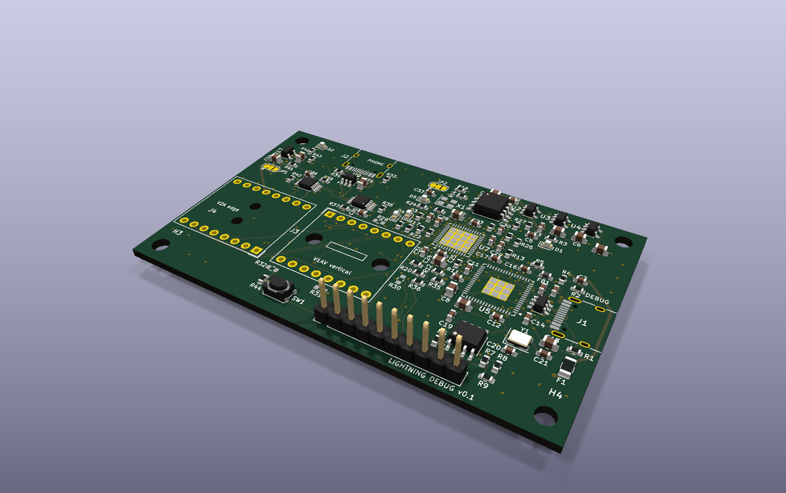
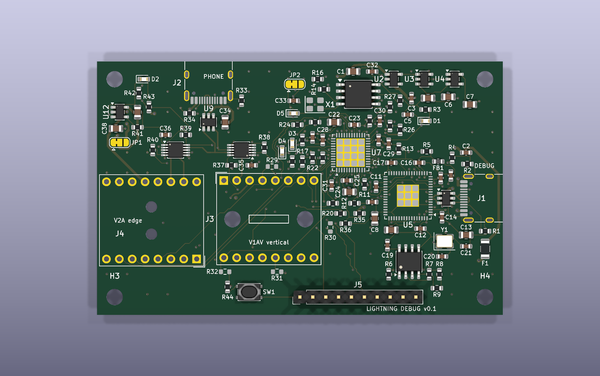
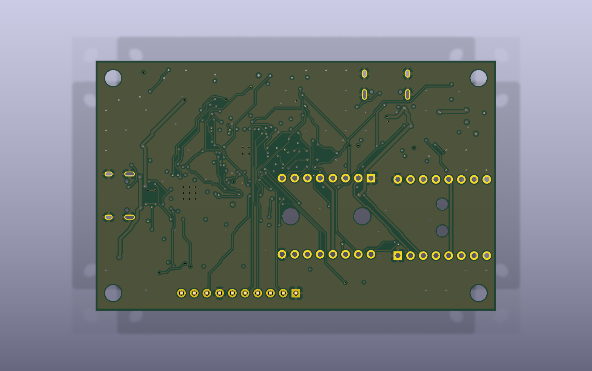

# Lightning debug board

A carrier board for an eLabGuy Lightning **male** breakout, for poking at (early)
iPhones from Linux. Plug a phone into the breakout and you get:

- **An FPGA on every Lightning signal pin.** All 12 data/ID contacts (both sides
  of the plug) go to an iCE40UP5K. It can sniff, emulate an accessory/cable chip
  (ID0/ID1), or drive a UART on the data lanes and stream it to the host.
- **USB-C #1 (DEBUG)** to the host. An FT2232H programs the FPGA's flash
  (`iceprog`) and gives a second channel (UART up to 12 Mbaud, or 30 MHz MPSSE)
  for log streaming. This port also powers the board.
- **USB-C #2 (PHONE)** for the phone's own USB. Analog switches connect the
  phone's USB lane straight through to a second host at full 480 Mb/s, or hand
  the lane to the FPGA instead. The FPGA also switches the phone's power (VBUS
  from this port, current-limited to 1 A).

KiCad 10 project: `lightning_debug.kicad_pro`. Board status: **routed, DRC
clean, fab files in `fab/release/`** (see [Status](#status) for what to check
before ordering).



| Top | Bottom |
|-----|--------|
|  |  |

*KiCad's stock libraries have no 3D models for the HRO USB-C receptacles or the
ASE oscillator, so those show only their pads. The breakout itself (J3/J4) is
drawn as its outline.*

## Architecture

```
 USB-C #1 (debug) ──► FT2232H ──ch.A (MPSSE/SPI)──► W25Q128 flash + iCE40 CRESET/CDONE   (iceprog)
       │                  └────ch.B (UART/MPSSE)──► iCE40UP5K bank 1
       └─ 5V ─► AP2112K 3.3 / 1.2 / 1.8

 USB-C #2 (phone) ─D+/D-─► FSUSB42 mux A ─► Lightning side A L0
                       └─► FSUSB42 mux B ─► Lightning side B L0
                                │ (other mux port = FPGA)
                VBUS2 ─► TPS2065C (FPGA PWR_EN, 1A) ─► Lightning PWR (pins 5/12)

 iCE40 bank 0 (VCCIO0, JP2: 3.3V default / 1.8V): L0 A/B (via the muxes), L1 A/B, EXP0-3, EXP5
 iCE40 bank 2 (1.8V):                             ID0/ID1 A/B, button, PWR fault, VBUS2 detect, EXP6
 iCE40 bank 1 (3.3V):                             SPI flash, 12 MHz clock, FT2232H ch.B, mux/power control
```

- **Both sides of the plug go to the FPGA,** so gateware handles orientation.
  GND (pins 1/16) and PWR (pins 5/12) are hard-wired.
- **Lightning pin map** (same on both breakouts):
  - Side A: 1 GND, 2 L0p, 3 L0n, 4 ID0, 5 PWR, 6 L1n, 7 L1p, 8 ID1.
  - Side B is mirrored: pin 17‑k carries the same signal as pin k (16 GND, 15 L0p, 14 L0n, 13 ID0, 12 PWR, 11 L1n, 10 L1p, 9 ID1).
- **Logic levels.** ID0/ID1 are 1.8 V (bank 2). The lanes' level isn't
  documented, so bank 0 is jumper-selectable: 3.3 V by default, 1.8 V via JP2.
- **USB passthrough** goes through analog muxes, not the FPGA, so it keeps
  480 Mb/s. Each mux works like this:

  | OE#  | SEL | Lightning L0 connected to |
  |------|-----|---------------------------|
  | 1    | x   | nothing (power-up default: 10k pull-up) |
  | 0    | 0   | FPGA (HSD1, rated for UART/USB) |
  | 0    | 1   | USB-C #2 (HSD2, USB only) |

  Enable at most one mux toward USB-C #2 at a time: the side the phone is touching.
- **Phone power** comes from USB-C #2 VBUS through the load switch. It is off
  by default (100k pull-down on PWR_EN). Bridge JP1 on 2‑3 instead of 1‑2 to
  power the phone from port 1.
- **33 Ω series resistors** sit on every FPGA ↔ Lightning line. Pull-ups on the
  ID lines are footprinted but not fitted.
- **User I/O:** button SW1, RGB LED (FPGA's constant-current sinks, `SB_RGBA_DRV`),
  and the 10-pin header J5. J5 pinout: 1 GND, 2 VCCIO0, 3–6 EXP0–3, 7 GND,
  8 EXP5, 9 EXP6, 10 +1V8. EXP4 was dropped: FPGA pin 42 could not be routed out
  past its neighbours, so it is left unconnected and J5 pin 7 is an extra GND.

### Solder jumpers

| JP  | default (1-2) | 2-3 |
|-----|---------------|-----|
| JP1 | phone PWR from USB-C #2 VBUS | from USB-C #1 (+5V) |
| JP2 | bank 0 (lanes) at 3.3V | bank 0 at 1.8V |

## Breakout install points (fit only ONE)

The two eLabGuy breakouts have mirrored pinouts, so each has its own footprint:

- **J3: APPLE-LM-BO-V1AV** (vertical plug). Top row is pins 1→8, bottom row 9→16.
- **J4: APPLE-LM-BO-V2A** (horizontal plug). Top row is 9→16, bottom row is
  8→1 with pin 1 at the bottom right. The plug hangs 10.7 mm past the board's
  left edge.

The footprints come from the drawings in `docs/` and are seen from the top,
with the breakout's silkscreen readable. **Before ordering, check one against a
real breakout:** print the PCB 1:1 and confirm the pin‑1 square pad position
and the plug direction. Both footprints have M3/M2 NPTH holes that line up with
the breakouts' own holes, for standoffs.

## Software

- Program the flash: `iceprog top.bin` (FT2232H default VID/PID 0403:6010; the
  EEPROM is optional).
- Logs: channel B shows up as `/dev/ttyUSB1`. UART runs up to 12 Mbaud, with
  RTS/CTS on BDBUS2/3. For more bandwidth, put channel B in MPSSE mode (SPI-like,
  30 MHz) on the same 4 pins.
- Pin constraints for nextpnr: `gateware/lightning_debug.pcf`.
- **Bring-up gateware:** `gateware/selftest.v` (`make -C gateware`, then
  `make -C gateware prog`). It uses every pin in the `.pcf`:
  - RGB LED cycles R → G → B.
  - J5 EXP pins output a slow binary count, so each header pin can be checked.
  - `/dev/ttyUSB1` at 115200 8N1 is a console. Any key prints a status line
    (ID lines, L1 and L0 lanes, button, VBUS2, power fault, power and mux
    state). `p` toggles Lightning power, `a`/`b` cycle mux A/B through
    off → FPGA → USB-C #2.
  - Holding the button forces Lightning power off.
  It builds with yosys + nextpnr-ice40 (or the pip-installable YoWASP builds, see
  the Makefile): no warnings, 233 LCs, 47 MHz achieved against the 12 MHz clock.

## PCB

- 80 × 50 mm, 4 layers, 1.6 mm:
  - **F.Cu:** signals.
  - **In1:** solid GND plane, the reference for the USB pairs. Only two short low-speed runs (EXP6, L1A_N_F) use it, kept 1 mm away from the USB nets.
  - **In2:** +3V3 pour plus signals; a lower-priority GND pour fills what the +3V3 pour can't reach.
  - **B.Cu:** signals plus GND pour.
- **Rules:** 0.15 mm track, 0.127 mm (5 mil) clearance, 0.5/0.3 mm vias. Power
  nets use 0.5 mm tracks and the USB/L0 nets 0.28 mm. All of this is inside
  JLCPCB's and PCBWay's standard 4-layer process.
- **Thermal and GND vias:** GND vias in the FPGA and FT2232H thermal pads, and
  GND stitching vias across the board.

## Status

- [x] Schematic: ERC clean (0 errors, 0 warnings).
- [x] PCB: placed, routed, DRC clean. That means 0 errors, 0 unconnected, and
      the board matches the schematic. The 4 remaining warnings come from the
      stock USB-C footprints' own silkscreen touching the board edge.
- [x] Gateware: `gateware/selftest.v` places and routes against the `.pcf`
      with every pin used, which confirms the pin file fits the SG48 package
      (banks, global clock input, RGB driver pins).
- [x] Netlist checked pin by pin against the datasheets:
  - **iCE40UP5K:** CRESET_B and CDONE have 10 kΩ pull-ups to SPI_VCCIO1 (3.3 V), as the datasheet asks.
  - **Config flash:** SPI_SO (pin 14) → flash DI, and SPI_SI (pin 17) ← flash DO.
  - **iceprog wiring:** the FT2232H port A pins match what iceprog expects: ADBUS0 SCK, ADBUS1 MOSI, ADBUS2 MISO, ADBUS4 CS, ADBUS6 CDONE, ADBUS7 CRESET.
  - **Pin banks:** IOB pins numbered 9 or lower are in bank 2 (1.8 V): button, power fault, VBUS2 detect, ID lines and EXP6. PWR_EN is on IOB_13b, which is bank 1 (3.3 V), and the TPS2065C's EN threshold is up to 2.0 V.
  - **FT2232H:** internal 1.8 V regulator wired to VCORE; VPHY/VPLL filtered through a ferrite; 12 kΩ 1 % REF resistor; TEST tied to GND; 93LC56B EEPROM with the 2.2 kΩ DO resistor.
  - **FSUSB42 (MSOP-10):** pinout matches the onsemi datasheet. SEL/OE are driven at 3.3 V (VIH 1.3 V). The defaults are OE high (disconnected) and SEL low (FPGA).
  - **Regulators, switch, ESD:** AP2112K, TPS2065C (DBV) and USBLC6-2SC6 pinouts match. USB-C CC pins have 5.1 kΩ to GND on both ports.
  - **VCCPLL:** the 100 Ω + 10 µF + 100 nF RC filter is the recommended "RC-based noise filter" (TN1252).
  - **RGB sinks:** the pins are rated 0–3.5 V regardless of VCCIO, so 3.3 V LED anodes are fine.
  - **VPP_2V5:** on 3.3 V, which master SPI configuration needs (≥ 2.3 V).
- [ ] **Signal integrity of the phone USB passthrough.** The USB2 D± and L0
      lanes (USB-C #2 → USBLC6 → FSUSB42 → breakout) were autorouted as
      separate 0.28 mm tracks, not coupled 90 Ω pairs.
      - The F.Cu parts sit over the solid In1 GND plane.
      - The parts on In2/B.Cu, about 30 mm per lane on the J3↔J4 legs and
        the mux → FPGA runs, often have no plane on the adjacent layer, because
        those two signal layers face each other across 0.2 mm. There the
        impedance is well above 90 Ω.
      - `tools/pour_islands.py` already rescues what pour it can with GND vias.
      - The two install points also leave a ~25 mm open stub on each lane from
        the unused connector.
      - FT2232H USB (USB-C #1) is short and fully referenced.
      - Expect full-speed and probably high-speed to work, but if the phone link
        has to be robust at 480 Mb/s, hand-route those lanes as coupled pairs
        on F.Cu or over a reserved GND area.
- [ ] Verify one breakout footprint 1:1 against the real part (see above).
- [ ] Fill in the LCSC part numbers in `tools/parts.csv` (see Ordering).

## Ordering (JLCPCB / PCBWay)

```
python3 tools/export_fab.py            # refuses while the board has unrouted nets / DRC errors
python3 tools/export_fab.py --preview  # dry run -> fab/UNROUTED-PREVIEW/ (DO NOT ORDER)
```

The script runs DRC first, then writes `fab/release/` (committed in this repo):

| File | JLCPCB | PCBWay |
|------|--------|--------|
| `lightning_debug-gerbers.zip` | "Add gerber file" | "Quick-order PCB" upload |
| `jlcpcb/bom.csv`, `jlcpcb/cpl.csv` | Assembly → BOM / CPL | – |
| `pcbway/bom.csv`, `pcbway/centroid.csv` | – | Assembly → BOM / Centroid |
| `assembly-excluded.txt` | parts you fit yourself (breakout, J5 header, DNP) | same |

PCB options to select:
- 4 layers, 1.6 mm thick, 80 × 50 mm, FR-4, 1 oz outer copper.
- Min track/space 0.15/0.127 mm, min via 0.3/0.5 mm.
- Impedance control on, for the USB pairs. Choose the fab's stackup (for
  JLCPCB, e.g. JLC04161H-7628).
- Assembly on the top side only. Every SMD part is on top.

Before you pay:
- **Part numbers.** Fill `tools/parts.csv`, then re-run the export. JLCPCB uses
  the `lcsc` column; PCBWay uses `manufacturer`/`mpn`. Only FSUSB42MUX → C11355
  has been verified. Rows without a number have to be matched by hand in the
  fab's BOM tool.
- **Rotation.** Check part rotation in the fab's placement preview, especially
  for the QFNs, SOT-23s, SOICs and USB-C connectors. KiCad's zero orientation
  and JLCPCB/PCBWay's don't always agree, and both let you fix it in their viewer.
- **Origin.** CPL coordinates use the board's bottom-left corner as origin
  (drill/place origin), with Y pointing up.

## Regenerating

The KiCad files were bootstrapped by the scripts in `tools/`. You can edit the
schematic and PCB in KiCad directly. To redo everything from the scripts:

```
python3 tools/gen_symlib.py && python3 tools/gen_footprints.py
python3 tools/gen_schematic.py && kicad-cli sch upgrade lightning_debug.kicad_sch
kicad-cli sch export netlist --format kicadxml -o /tmp/net.xml lightning_debug.kicad_sch
python3 tools/gen_pcb.py /tmp/net.xml        # WARNING: overwrites the PCB (placement, no tracks)
python3 tools/autoroute.py                   # Freerouting, headless
python3 tools/finish_route.py                # rip-up/re-route what is left, GND stitching
python3 tools/pour_islands.py                # In2 GND fill + GND vias so pour islands survive
python3 tools/silk.py                        # place reference designators
```

- `autoroute.py` runs [Freerouting](https://github.com/freerouting/freerouting) 2.x
  **headless** (`--gui.enabled=false`, no `DISPLAY`, `java.awt.headless`). It uses
  the newest `~/.local/share/freerouting/freerouting-2.*.jar` and a Java 25
  runtime for 2.5+ (or set `FREEROUTING_JAR` / `FREEROUTING_JAVA`).
- `finish_route.py` is a small grid A* router built on KiCad's own geometry. It:
  - takes the autorouter's open connections from KiCad's DRC report;
  - keeps In1 free of tracks, except as a last resort for low-speed nets, 1 mm from the USB nets;
  - rips up neighbours only when plain routing makes no progress.
- The autorouter results depend on placement. The committed board comes from
  several placement variants (`PCB_U7`/`PCB_MARGIN` knobs in `gen_pcb.py`). The
  one routed and committed had the FPGA rotated 90°. Even then, the last
  connection (EXP4) was dropped by hand, so a fresh run won't necessarily come
  out clean.

Refresh the 3D renders:

```
kicad-cli pcb render -o renders/top.png --side top --quality high --background opaque -w 1600 -h 1000 --zoom 1.1 lightning_debug.kicad_pcb
kicad-cli pcb render -o renders/bottom.png --side bottom --quality high --background opaque -w 1600 -h 1000 --zoom 1.1 lightning_debug.kicad_pcb
kicad-cli pcb render -o renders/iso.png --quality high --background opaque --perspective --rotate '-50,0,-30' -w 1600 -h 1000 --zoom 0.9 lightning_debug.kicad_pcb
```
